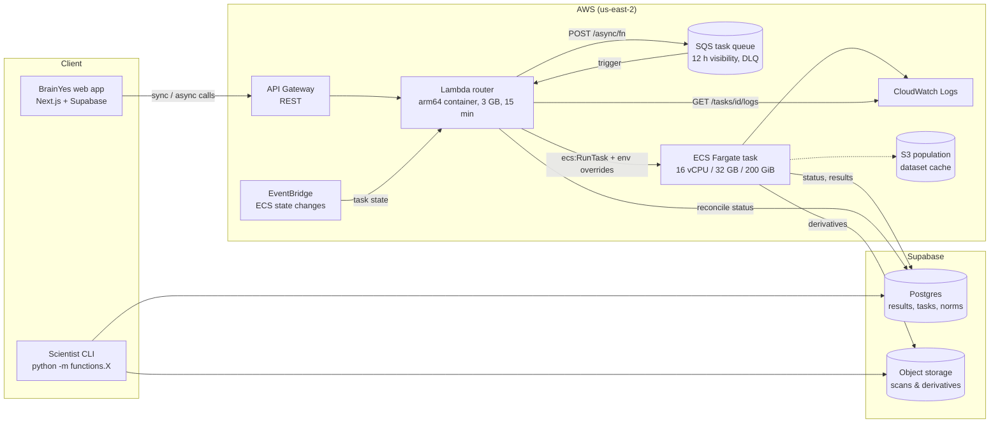
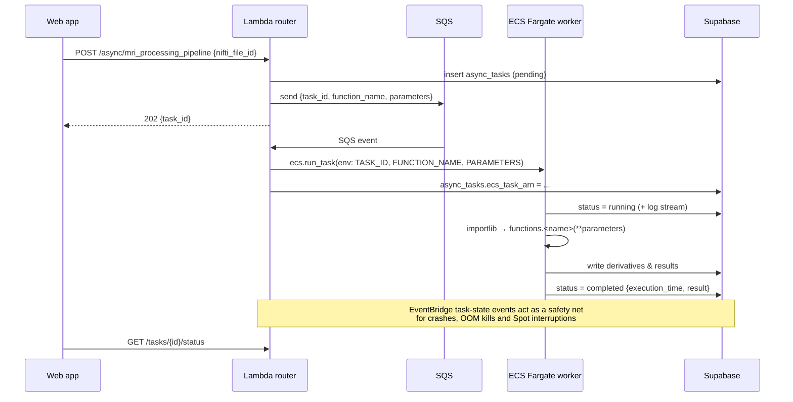
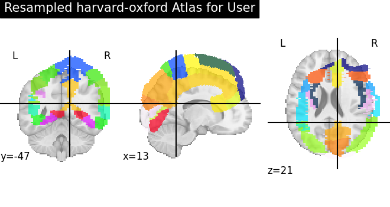
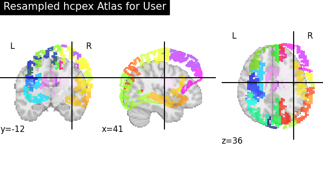
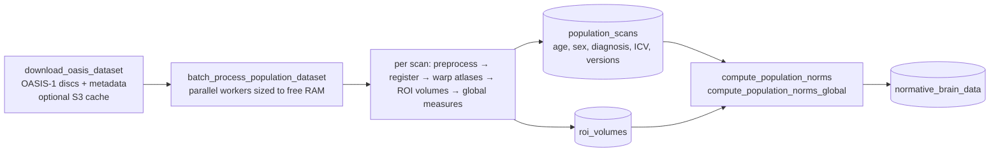

# BrainYes Engine

**A cloud-native neuroimaging engine that turns a single structural brain MRI into quantitative, population-referenced insight.**

BrainYes Engine is the computational backend of [BrainYes](https://brainyes.com), a platform where a person uploads their own T1-weighted brain MRI (NIfTI or DICOM) and receives a structured, research-grade portrait of their brain: regional volumes across hundreds of anatomical regions, cortical surface reconstructions, interactive 3D meshes, memory-system metrics, and age-, sex- and head-size-aware comparisons against a normative population.

The engine packages a research-grade neuroimaging stack (ANTs, HD-BET, FreeSurfer, FastSurfer, nilearn, nibabel) as composable, individually callable functions. These run on demand on serverless infrastructure: lightweight calls execute in AWS Lambda, while multi-hour reconstructions run as on-demand ECS Fargate tasks with up to 16 vCPU and 32 GB RAM. Everything is persisted to Postgres and object storage through Supabase.

> BrainYes is an informational and research tool. It is **not** a medical device and does not provide diagnosis.

---

## Table of contents

1. [What the engine does](#what-the-engine-does)
2. [System architecture](#system-architecture)
3. [The scientific pipeline](#the-scientific-pipeline)
4. [Population norms and statistical model](#population-norms-and-statistical-model)
5. [Surface reconstruction: FastSurfer and FreeSurfer](#surface-reconstruction-fastsurfer-and-freesurfer)
6. [Visualization assets](#visualization-assets)
7. [Insights framework](#insights-framework)
8. [Data model](#data-model)
9. [Engineering design](#engineering-design)
10. [Repository layout](#repository-layout)
11. [Getting started](#getting-started)
12. [Deployment](#deployment)
13. [Testing](#testing)
14. [Datasets, atlases, tools and citations](#datasets-atlases-tools-and-citations)
15. [Project status](#project-status)

---

## What the engine does

For every uploaded scan, the engine produces:

| Output | Description |
|---|---|
| **Clean native-space brain** | N4 bias-field-corrected, deep-learning skull-stripped T1 with a brain mask |
| **Intracranial volume (ICV)** | Head-size covariate used to normalize all regional measures |
| **Nonlinear registration** | Diffeomorphic (ANTs SyN) forward and inverse warps between the subject and a standard template |
| **Native-space atlases** | Harvard-Oxford (48 cortical regions) and HCPex (426 cortical + subcortical regions) warped *into the subject's own anatomy* |
| **Regional volumes** | Per-region volumes in mm³ for every atlas label, plus derived global measures |
| **Cortical surfaces & parcellations** | Full FastSurfer / FreeSurfer reconstruction: pial and white surfaces, Desikan-Killiany / DKT / Destrieux parcellations, subcortical segmentation, thickness and curvature statistics |
| **Population comparison** | Per-region z-scores and percentiles against age- and sex-stratified norms built from the OASIS-1 cohort |
| **Memory-system metrics** | Hippocampal volumes, hemispheric symmetry, entorhinal / temporal / prefrontal volumes with age-matched percentiles |
| **Web-ready 3D assets** | Per-region triangle meshes, browser-optimized volumes for NiiVue, ASCII surfaces and per-vertex parcellation JSON for Three.js |

The consumer of these outputs is the BrainYes web dashboard (a Next.js + Supabase app, a separate repo). It renders them as summary, regional volume, population norm, memory, cortical, subcortical, curvature and interactive 3D views.

---

## System architecture



### Design: one codebase, three execution surfaces

Every unit of work lives in `functions/<name>.py` and exposes a callable with the same name as the module. The **same function** can be run three ways, with no code changes:

1. **CLI**: `python -m functions.calculate_roi_volumes <FILE_ID>` for scientists and local development.
2. **Synchronous API**: `POST /function/{function_name}` runs it inside Lambda and returns the result.
3. **Asynchronous API**: `POST /async/{function_name}` queues it for a dedicated Fargate container (used for anything long-running: registration, skull-stripping, surface reconstruction).

Functions are discovered at runtime by filesystem glob and loaded with `importlib`, so there is no registry to maintain: adding a file to `functions/` adds an endpoint.

### Routing (`handlers/lambda_handlers.py`)

A single Lambda (`router_handler`) serves every route, which keeps one image, one warm pool and one IAM policy:

| Trigger | Route | Behavior |
|---|---|---|
| API Gateway | `GET /functions` | List all callable functions |
| API Gateway | `POST /function/{name}` | Run synchronously, return `{success, function, data}` |
| API Gateway | `POST /async/{name}` | Insert an `async_tasks` row (`pending`), enqueue to SQS, return `task_id` |
| API Gateway | `GET /tasks/{id}/status` | Task status and result |
| API Gateway | `GET /tasks/{id}/logs` | Stream the task's CloudWatch logs |
| SQS | (event source, batch size 1) | `ecs:RunTask` with `TASK_ID`, `FUNCTION_NAME`, `PARAMETERS` container overrides |
| EventBridge | ECS Task State Change | Reconcile `async_tasks` status (`running` / `completed` / `failed`, including Spot interruption) |

### Asynchronous task lifecycle



Each long job gets its own isolated container with no shared state, no idle fleet, and cost proportional to work actually done.

---

## The scientific pipeline

The production orchestrator is `functions/mri_processing_pipeline.py`. It runs end-to-end inside one Fargate task:

```mermaid
flowchart TD
    A[Upload: NIfTI, or DICOM → dcm2niix] --> B
    subgraph CORE["Core volumetric pipeline (registration-based)"]
        B[1 · preprocess_native_scan<br/>N4 bias correction · HD-BET skull strip · ICV]
        C[2 · register_to_template<br/>ANTs SyN → MNI152]
        D[3 · resample_atlas_for_user_nifti<br/>inverse warp atlases → native space]
        E[4 · calculate_roi_volumes<br/>+ compute_global_measures_from_rois]
        F[5 · prepare_volume_visualization<br/>per-region 3D meshes]
        G[6 · calculate_memory_metrics]
        H[7 · compare_to_population_norms<br/>z-scores & percentiles]
        B --> C --> D --> E --> F --> G --> H
    end
    H --> P
    subgraph SURF["Surface pipeline"]
        P[8 · fastsurfer_recon_all  (or freesurfer_recon_all)]
        Q[9 · freesurfer_store_files]
        R[10 · FreeSurfer-atlas ROI volumes]
        S[11 · generate_surface_files]
        T[12 · freesurfer_parse_statistics]
        U[13 · generate_visualization_data]
        P --> Q --> R --> S --> T --> U
    end
```

### 1. Ingest

- **NIfTI** (`.nii`, `.nii.gz`) is stored as-is; a parent/child relationship links the raw and compressed copies (`nifti_files.parent_nifti_file_id`).
- **DICOM** series are converted with `dcm2niix` (`functions/dicom_to_nifti_converter.py`), and the converter automatically triggers the full pipeline on the result.
- **Input validation** (`utilities/nifti_validation.py`) rejects RGB or structured dtypes, recovers void dtypes, sanity-checks dimensions and voxel spacing, and squeezes single-volume 4D images to 3D.

### 2. Preprocessing: `functions/preprocess_native_scan.py`

| Step | Method | Rationale |
|---|---|---|
| Bias-field correction | **N4** (SimpleITK `N4BiasFieldCorrectionImageFilter`) | Removes low-frequency intensity inhomogeneity from RF coil and field effects, which otherwise biases registration and segmentation |
| Skull stripping | **HD-BET** (Isensee et al., 2019) with test-time augmentation, auto-selecting CUDA → Apple MPS → CPU; falls back to FSL BET, then an intensity-threshold method | Deep-learning brain extraction is robust across scanners, field strengths and pathology, where classic BET often fails |
| Intracranial volume | Brain-mask voxel count × voxel volume | Head-size covariate. Regional brain volumes scale with head size, so comparisons without ICV adjustment conflate "big head" with "big region" |

Outputs: `preprocessing/brain_n4.nii.gz`, `preprocessing/brain_mask.nii.gz`.

### 3. Registration: `functions/register_to_template.py`

The skull-stripped brain is registered to a standard template with **ANTs SyN** (symmetric normalization: affine initialization followed by a diffeomorphic deformation, with mutual-information similarity). The forward warp, inverse warp and affine are persisted, so atlases and any future label set can be mapped into the subject without re-registering.

- **Templates:** FSL `MNI152_T1_1mm_brain` (default, used for both user scans and population scans so the norms and the individual measurements share one reference frame), plus the ANTs **OASIS** template with pre-computed MNI → OASIS warps for age-matched population work.
- **Fallback:** a SimpleITK affine registration (Mattes MI, 3-level pyramid) when ANTs is unavailable.
- Tool selection is capability-driven (`utilities/dependency_checker.py`), so the same code runs on a GPU workstation, an Apple-silicon laptop or a CPU-only Fargate task.

### 4. Atlas warping into native space: `functions/resample_atlas_for_user_nifti.py`

Instead of normalizing the subject into atlas space (which distorts the subject's volumes), the engine pulls the **atlas into the subject's native space** by composing the inverse transforms:

```python
ants.apply_transforms(
    fixed=brain_n4,              # subject, native space
    moving=atlas,                # MNI-space label map
    transformlist=[affine, inverse_warp],
    interpolator="nearestNeighbor",   # labels must stay integers
)
```

The warped label map is then masked to brain tissue and stored as `int16`. Measuring in native space means every volume reflects the subject's real anatomy in real millimetres.

<p align="center">
  
  
</p>
<p align="center"><sub>Harvard-Oxford (left) and HCPex (right) atlases mapped onto an OASIS-1 subject's T1.</sub></p>

### 5. Regional volumes: `functions/calculate_roi_volumes.py`

For each label *ℓ*:

$$V_\ell = \left|\{\,x : A(x)=\ell \;\wedge\; B(x)>0\,\}\right| \cdot v_{\text{voxel}}$$

where *A* is the native-space atlas, *B* the brain mask, and *v*<sub>voxel</sub> the voxel volume in mm³. Atlases with more than 100 labels are processed in parallel across CPU cores. Results are upserted to `roi_volumes` on `(nifti_file_id, label, atlas_name)`, tagged with a `processing_version` for provenance.

`compute_global_measures_from_rois.py` then derives FreeSurfer-style global measures (total brain segmentation, cortical and white-matter volume, eTIV) so that every scan has a global summary even before surface reconstruction finishes.

### 6. Memory-system metrics: `functions/calculate_memory_metrics.py`

A focused panel on the medial-temporal memory system:

- left, right and total **hippocampal volume**
- **hemispheric symmetry**: `L / (L + R) × 100` (50 = perfectly symmetric)
- **entorhinal**, **temporal-lobe** and **prefrontal** volumes
- age- and sex-matched **percentiles** against literature-derived norms (e.g. Nobis et al., 2019)

The best available source is used: FreeSurfer/FastSurfer segmentation first, then HCPex, then Harvard-Oxford.

---

## Population norms and statistical model

### Building the reference population

`functions/batch_process_population_dataset.py` turns a public research cohort into a normative database using **exactly the same pipeline** as user scans. That symmetry matters: a subject is only comparable to norms produced by the same preprocessing, template, atlases and measurement code.



The batch processor is resumable (`--offset`, `--count`) and version-aware: scans already processed with the current pipeline are skipped, older ones are reprocessed. It filters out pre-normalized or derived OASIS images by filename so that only raw native T1s enter the norms, and sizes its worker pool to `min(CPUs − 1, free RAM / 4 GB)`.

### Normative statistics: `functions/compute_population_norms.py`

Norms are stratified per **atlas × region × age bin (10 years) × sex** (M, F, and a combined stratum), with a minimum of **30 subjects** per stratum. For each stratum the engine stores:

- mean and sample standard deviation
- empirical percentiles p10, p25, p50, p75, p90
- an **ICV-adjusted regression model**:

$$V = \beta_0 + \beta_1\,\text{age} + \beta_2\,\text{age}^2 + \beta_3\,\text{sex} + \beta_4\,\text{ICV} + \varepsilon$$

  with its coefficients, R² and residual standard deviation σ<sub>res</sub>, persisted as JSON. The quadratic age term captures the non-linear trajectory of brain atrophy across the lifespan; the ICV term removes head-size effects.

### Comparing an individual: `functions/compare_to_population_norms.py`

For each region, the engine looks up the matching stratum (falling back from sex-specific to combined, and to a global stratum for whole-brain measures) and computes:

$$z = \frac{V_{\text{subject}} - \hat{V}}{\sigma}, \qquad \text{percentile} = 100\cdot\Phi(z)$$

where $\hat{V}$ is the stratum mean, or the ICV-adjusted model prediction with σ = σ<sub>res</sub>. Regions are flagged as outliers at |z| > 2, and the dashboard color-codes them: green (|z| < 1.5), amber (1.5–2), red (≥ 2). Results are written to `population_comparisons`.

---

## Surface reconstruction: FastSurfer and FreeSurfer

Volumetric atlases give fast, robust regional volumes. Cortical thickness, surface area, curvature and vertex-level parcellations need a full surface reconstruction. The engine supports both:

| | **FastSurfer** (default) | **FreeSurfer** |
|---|---|---|
| Method | Deep-learning segmentation (FastSurferCNN) + fast surface pipeline (recon-surf) | Classical `recon-all -all` |
| Runtime | ~5 min segmentation-only (GPU); ~60–90 min full | many hours |
| Integration | `functions/fastsurfer_recon_all.py`, vendored as a git submodule ([brainyes/FastSurfer](https://github.com/brainyes/FastSurfer)) | `functions/freesurfer_recon_all.py` |

Both write the standard FreeSurfer subject layout, so everything downstream is shared:

- **`freesurfer_store_files`** uploads outputs under three storage tiers: `segmentation_only` (~30 MB), `essential` (~50 MB) and `complete` (~230 MB).
- **`freesurfer_parse_statistics`** (`utilities/freesurfer_parsers.py`) parses `aseg`, `brainvol`, `wmparc`, `aparc`, `aparc.DKTatlas`, `aparc.a2009s` and curvature stats into normalized tables. It auto-detects FastSurfer outputs and tags each row with `processing_method`.
- The FreeSurfer `aparc+aseg` segmentation is also run through the ROI-volume path as a third atlas, alongside Harvard-Oxford and HCPex.

The Docker image carries both FreeSurfer 7.4.1 (required by FastSurfer) and FreeSurfer 8 as separate build targets.

---

## Visualization assets

The engine pre-computes everything the browser needs, so the frontend never touches raw MRI processing:

| Asset | Producer | Format |
|---|---|---|
| Per-region 3D meshes | `prepare_volume_visualization.py`: marching cubes (scikit-image) on each label mask → voxel-to-RAS transform → ~50 % quadric decimation (trimesh), parallel across cores | `region_meshes/{atlas}/region_{label}.json` (flat `vertices` / `faces` arrays) + `metadata.json` |
| Cortical surfaces | `generate_surface_files.py`: `mris_convert` of `{lh,rh}.pial` | ASCII `.asc` for Three.js |
| Vertex-wise parcellations | `generate_visualization_data.py`: `.annot` → JSON (Desikan-Killiany, DKT, Destrieux, custom) | `{hemi}.{parc}.regions.json` with per-vertex labels and region color table |
| Browser-optimized volumes | `prepare_visualization_nifti.py`: brain cropped with padding (native) and a downsampled MNI-space copy | `.nii.gz` + crop parameters, for NiiVue |
| Atlas color maps | `export_atlas_labels.py`: perceptually spaced colors via golden-ratio hue stepping in HSV | `{atlas}.labels.json` |

All visualization assets live under `freesurfer-outputs/{nifti_id}/visualization/`.

---

## Insights framework

`insights/` holds a lightweight framework for turning published neuroscience into per-user analyses. An insight is a self-contained, reviewable script:

```python
INSIGHT_NAME = "thalamus-volume-reduction"   # registered in the `insights` table at import

def main(nifti_id, user_id, **kwargs):
    # --- PAPER STARTS ---
    insight = get_user_insight(INSIGHT_NAME, user_id, nifti_id)
    volumes = get_roi_volumes(nifti_id)
    ...                                       # method from the source paper
    save_insight_output(insight, "summary", result)
    save_insight_output_file(insight, "figure.png", fig)
    # --- PAPER ENDS ---
```

The `PAPER STARTS` / `PAPER ENDS` block isolates the scientific method from the plumbing, so a researcher can port a paper's analysis without learning the infrastructure. Outputs (values, tables, figures) are versioned per user and scan in `user_insights` / `user_insight_outputs`.

Prototype insights include:

- **Thalamic volume vs. schizophrenia meta-analytic data** (Adriano et al., 2010, *Schizophrenia Research*)
- **Subcortical volumes vs. the ENIGMA-ADHD mega-analysis** (Hoogman et al., 2017, *Lancet Psychiatry*)
- **Regional volume ↔ cognition correlations** on OASIS-1 (MMSE, CDR, age, education)

---

## Data model

### Postgres tables (Supabase)

| Domain | Tables |
|---|---|
| Scans | `nifti_files`, `dicom_series` |
| Orchestration | `async_tasks` (status, ECS task ARN, log stream, result, traceback) |
| Volumetrics | `roi_volumes`, `memory_metrics` |
| Surface reconstruction | `freesurfer_global_measures`, `freesurfer_cortical_regions`, `freesurfer_subcortical_segmentations`, `freesurfer_curvature_stats`, `freesurfer_summary_stats` |
| Population | `population_scans`, `normative_brain_data`, `population_comparisons` |
| Insights | `insights`, `user_insights`, `user_insight_outputs` |
| Users | `users` (age, sex, date of birth), `usermeta` |

Schema migrations live in the companion `app` repository (`supabase/migrations`), which owns the database.

### Object storage

| Bucket | Layout |
|---|---|
| `nifti_gz_files` | `{user_id}/{timestamp}.nii[.gz]`, `{user_id}/dicom/{series_id}/…`, `{user_id}/{nifti_id}/{atlas}-resampled.nii.gz` |
| `freesurfer-outputs` | `{nifti_id}/preprocessing/…`, `{nifti_id}/registration/…`, `{nifti_id}/{mri,surf,label,stats}/…`, `{nifti_id}/visualization/…` |
| `user_insight_outputs` | `{user_insight_id}/{output_name}` |

---

## Engineering design

- **Function-as-unit architecture.** Each processing step is a pure-ish function keyed on a scan ID, independently runnable, testable and re-runnable. The orchestrator is just another function composing them.
- **Idempotency by construction.** Database writes are upserts with explicit conflict keys, storage uploads overwrite, and batch jobs are resumable and version-aware. Any step can be safely re-run after a failure.
- **Provenance everywhere.** Processing version, registration method, skull-strip method and atlas source are recorded alongside every measurement, so methodological changes are auditable and old results can be found and reprocessed.
- **Graceful capability degradation.** `dependency_checker` probes for HD-BET / FSL / ANTs and for CUDA / MPS / CPU at runtime and selects the best available method, so one codebase runs from a laptop to Fargate.
- **Correctness details that matter in imaging.** Nearest-neighbour interpolation for all label maps, label maps stored as `int16`, atlases masked to brain tissue, input validation before any processing.
- **Parallelism at every level.** Process pools across population scans, worker pools across atlas labels and mesh generation, worker counts sized to available memory.
- **Resilience.** Retries with backoff on storage timeouts, paginated and split-on-error database reads, batched inserts, SQS dead-letter queue, EventBridge-based task status reconciliation.
- **Cost model.** No always-on compute: Lambda for control-plane calls, on-demand Fargate tasks for heavy jobs, no NAT gateway (public subnets with egress-only security groups), Intelligent-Tiering on the dataset cache, and ECR lifecycle policies.
- **Infrastructure as code.** VPC, queues, cluster, task definitions, IAM, ECR and the CI/CD pipelines are all declared in SAM / CloudFormation.

---

## Repository layout

```
engine/
├── functions/              # Every processing step; one module = one callable = one API endpoint
│   ├── mri_processing_pipeline.py        # Production orchestrator
│   ├── preprocess_native_scan.py         # N4 + HD-BET + ICV
│   ├── register_to_template.py           # ANTs SyN
│   ├── resample_atlas_for_user_nifti.py  # Atlas → native space
│   ├── calculate_roi_volumes.py
│   ├── compute_population_norms*.py
│   ├── compare_to_population_norms.py
│   ├── batch_process_population_dataset.py
│   ├── fastsurfer_recon_all.py / freesurfer_recon_all.py
│   ├── freesurfer_store_files.py / freesurfer_parse_statistics.py
│   ├── prepare_volume_visualization.py / generate_*.py
│   └── template.py                       # Scaffold for new functions
├── utilities/              # Supabase I/O, registration helpers, atlas registry, parsers, validation
├── handlers/               # Lambda router and ECS worker entrypoints
├── insights/               # Paper-to-user insight scripts
├── research/input/         # Atlases (Harvard-Oxford, HCPex), templates (MNI152, OASIS), sample scans
├── FastSurfer/             # Git submodule
├── docs/                   # Deep-dive guides (population norms, FastSurfer, storage, deployment)
├── tests/                  # Function-level integration test runner
├── pipeline/               # CodeBuild buildspecs
├── Dockerfile              # ECS worker image (Ubuntu + Python 3.12 + FreeSurfer 7/8 + FastSurfer)
├── Dockerfile.lambda       # Lambda image (AWS Python 3.12 base)
├── template-docker.yaml    # SAM: VPC, API Gateway, Lambda, SQS, ECS, IAM, S3
└── codepipeline*.yaml      # CI/CD pipelines (app stack, engine image, FreeSurfer base image)
```

---

## Getting started

### Prerequisites

- Python 3.12
- A Supabase project with the BrainYes schema (migrations live in the `app` repo)
- Optional, for full functionality: [HD-BET](https://github.com/MIC-DKFZ/HD-BET) (installed via pip), FreeSurfer 7.x with a [license file](https://surfer.nmr.mgh.harvard.edu/registration.html), `dcm2niix`, and a CUDA or Apple-silicon GPU
- To build the Docker images, place your own FreeSurfer license at `./freesurfer_license.txt` (gitignored; licenses are per-registrant and not redistributable)

### Install

```bash
git clone --recurse-submodules https://github.com/brainyes/engine.git
cd engine
python3.12 -m venv .venv && source .venv/bin/activate
pip install -r requirements.txt

export SUPABASE_URL=...
export SUPABASE_KEY=...

python -m utilities.dependency_checker   # reports which methods are available on this machine
```

### Run a scan end-to-end

```bash
# Upload a sample OASIS-1 T1 (prints the new FILE_ID)
python -m functions.upload_nifti research/input/raw/sub-OASIS10001_ses-M00_T1w.nii.gz

# Full pipeline
python -m functions.mri_processing_pipeline $FILE_ID

# ...or step by step
python -m functions.preprocess_native_scan $FILE_ID
python -m functions.register_to_template $FILE_ID
python -m functions.resample_atlas_for_user_nifti $FILE_ID --population-mode
python -m functions.calculate_roi_volumes $FILE_ID
python -m functions.compare_to_population_norms $FILE_ID --age 45 --sex M

# Surface reconstruction
python -m functions.fastsurfer_recon_all $FILE_ID --seg-only --device cuda
```

Every function has `--help`.

### Build population norms

```bash
python -m functions.download_oasis_dataset --dataset oasis-1 --count 100
python -m functions.batch_process_population_dataset research/input/datasets/oasis-1/raw \
    --dataset oasis-1 --metadata research/input/datasets/oasis-1/selected_subjects.csv
python -m functions.compute_population_norms --dataset oasis-1 --min-samples 30
python -m functions.compute_population_norms_global --dataset oasis-1
```

### Write a new function

Copy `functions/template.py` to `functions/my_step.py` and define `def my_step(nifti_file_id, **kwargs) -> dict`. It is immediately available as `python -m functions.my_step`, `POST /function/my_step` and `POST /async/my_step`. See [`docs/FUNCTION_DEVELOPMENT_GUIDE.md`](docs/FUNCTION_DEVELOPMENT_GUIDE.md).

### Environment variables

| Variable | Used by | Purpose |
|---|---|---|
| `SUPABASE_URL`, `SUPABASE_KEY` | all | Database and storage access |
| `TASK_QUEUE_URL` | Lambda | SQS queue for async tasks |
| `SUBNET_1`, `SUBNET_2`, `SECURITY_GROUP` | Lambda | Fargate networking for `RunTask` |
| `POPULATION_DATASET_BUCKET` | Lambda, ECS | S3 cache for public datasets |
| `TASK_ID`, `FUNCTION_NAME`, `PARAMETERS` | ECS | Injected per task by the router |
| `FREESURFER_HOME`, `FREESURFER7_HOME`, `FS_LICENSE`, `FASTSURFER_HOME` | ECS image | Toolchain locations |
| `SENTRY_DSN` | optional | Error reporting; disabled when unset |

---

## Deployment

The stack is defined in `template-docker.yaml` (AWS SAM) and deployed by AWS CodePipeline.

| Pipeline | Stages |
|---|---|
| `codepipeline.yaml` (application) | GitHub source → `sam build` / `sam package` (Lambda image to ECR) → `sam deploy` to production |
| `codepipeline-engine.yaml` (ECS worker image) | manual approval → Docker build with layer cache → push to ECR → register new task definition revision |
| `codepipeline-freesurfer.yaml` (base image) | build the FreeSurfer base layer once, reuse it across engine builds |

The FreeSurfer installation is the heaviest layer, so it is built once into a reusable base image. Engine builds then only rebuild the Python layers on top:

```bash
docker build --target runtime   .   # FreeSurfer 8 runtime
docker build --target runtime-7 .   # FreeSurfer 7 runtime (required by FastSurfer)
```

Manual deploy:

```bash
sam build  --template-file template-docker.yaml
sam deploy --template-file template-docker.yaml --guided
```

See [`docs/SERVERLESS_DEPLOYMENT.md`](docs/SERVERLESS_DEPLOYMENT.md).

---

## Testing

```bash
python tests/test_functions.py                          # quick integration suite
python tests/test_functions.py --full                   # include slow functions
python tests/test_functions.py --function calculate_roi_volumes --verbose
```

The suite runs each function against a reference NIfTI and DICOM series in a live Supabase project, checking that every step executes and produces its expected outputs. `handlers/test_lambda_local.py` exercises the Lambda router with synthetic API Gateway, SQS and EventBridge events. See [`tests/README.md`](tests/README.md).

---

## Datasets, atlases, tools and citations

**Data**

- **OASIS-1** (cross-sectional). Marcus, D. S. et al. (2007). *Open Access Series of Imaging Studies (OASIS): cross-sectional MRI data in young, middle aged, nondemented, and demented older adults.* J Cogn Neurosci 19(9):1498–1507. Data provided by OASIS (PIs D. Marcus, R. Buckner, J. Csernansky, J. Morris; P50 AG05681, P01 AG03991, P01 AG026276, R01 AG021910, P20 MH071616, U24 RR021382). Use is subject to the OASIS Data Use Agreement.
- Preprocessing conventions for the OASIS course material follow Wen, J. et al. (2020). *Convolutional neural networks for classification of Alzheimer's disease: overview and reproducible evaluation.* Medical Image Analysis.

**Atlases and templates**

- **Harvard-Oxford cortical atlas** (maxprob, thr25, 2 mm). Harvard Center for Morphometric Analysis, distributed with FSL.
- **HCPex** v1.1: extended HCP-MMP1.0 parcellation with subcortical regions. Huang, C.-C. et al. (2022). Brain Structure and Function.
- **MNI152** T1 1 mm brain template (FSL).
- **ANTs OASIS template** with tissue priors (Avants, Tustison et al.).
- **FreeSurfer** Desikan-Killiany, DKT and Destrieux parcellations.

**Tools**

- **ANTs / ANTsPy**: Avants, B. B. et al. (2008). *Symmetric diffeomorphic image registration with cross-correlation.* Medical Image Analysis 12(1):26–41.
- **N4**: Tustison, N. J. et al. (2010). *N4ITK: improved N3 bias correction.* IEEE TMI 29(6):1310–1320.
- **HD-BET**: Isensee, F. et al. (2019). *Automated brain extraction of multisequence MRI using artificial neural networks.* Human Brain Mapping 40(17):4952–4964.
- **FastSurfer**: Henschel, L. et al. (2020). *FastSurfer: a fast and accurate deep learning based neuroimaging pipeline.* NeuroImage 219:117012; Henschel, L. et al. (2022). *FastSurferVINN.* NeuroImage 251:118933.
- **FreeSurfer**: Fischl, B. (2012). *FreeSurfer.* NeuroImage 62(2):774–781.
- **dcm2niix**: Li, X. et al. (2016). J Neurosci Methods 264:47–56.
- **nibabel**, **nilearn**, **SimpleITK**, **scikit-image**, **trimesh**, **scikit-learn**.

**Literature used by insights and memory metrics**

- Hoogman, M. et al. (2017). Subcortical brain volume differences in participants with ADHD. *Lancet Psychiatry* 4(4):310–319.
- Adriano, F. et al. (2010). Updated meta-analyses reveal thalamus volume reduction in patients with first-episode and chronic schizophrenia. *Schizophrenia Research* 123(1):1–14.
- Nobis, L. et al. (2019). Hippocampal volume across age: nomograms derived from over 19,700 people in UK Biobank. *NeuroImage: Clinical* 23:101904.

---

## Project status

BrainYes Engine was actively developed from October 2024 to November 2025 and is published here as a reference implementation of the architecture and methods described above. It is research software: outputs are informational and have not been clinically validated.

Deeper documentation lives in [`docs/`](docs/), including the [population norms guide](docs/POPULATION_NORMS_GUIDE.md), [FastSurfer integration](docs/FASTSURFER_INTEGRATION.md), [OASIS template setup](docs/OASIS_TEMPLATE_SETUP.md) and [storage structure analysis](docs/STORAGE_STRUCTURE_ANALYSIS.md).
